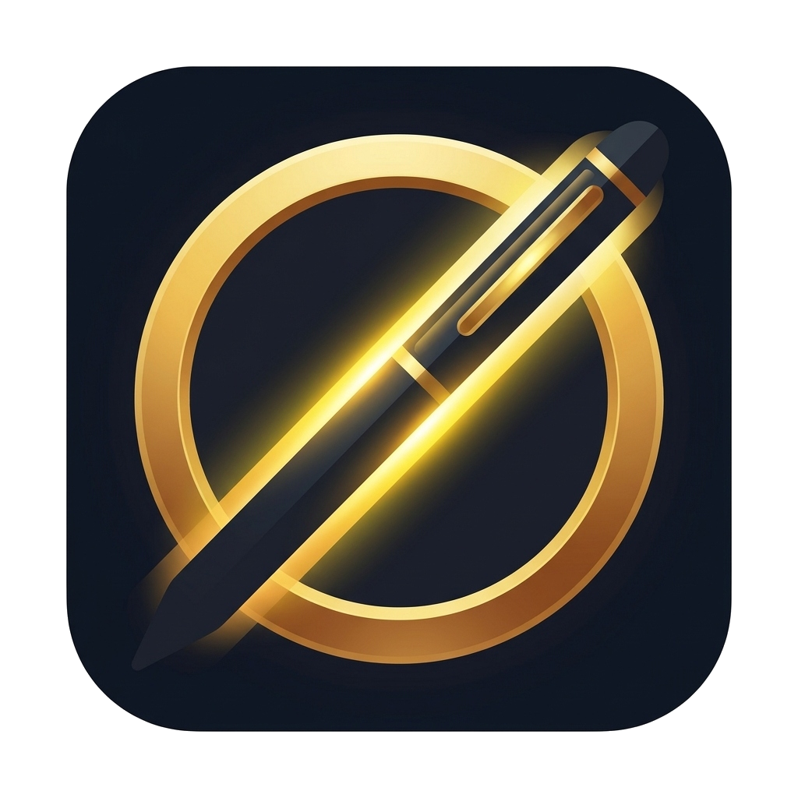

<p align="center">
  
</p>

# SpotPen

**Distraction-free screen annotation and instant spotlight presentations for macOS.**

SpotPen turns your entire screen into an immediate, presentation-ready canvas. Draw smoothly over any active application with a single calibrated precision pen, or hold <kbd>Shift</kbd> to focus audience attention under a gentle radial spotlight. No toolbars to manage, no palette configuration, and no interruption to your presentation flow.

<p align="center">
  <a href="https://github.com/unamatasanatarai/SpotPen/releases/latest"><b>Download Latest Release</b></a> •
  <a href="#quick-start"><b>Quick Start</b></a> •
  <a href="#how-it-works"><b>How It Works</b></a> •
  <a href="#keyboard-and-mouse-controls"><b>Shortcuts</b></a>
</p>

<p align="center">
  
  
  
  
  
  
</p>

---

<p align="center">
  
</p>

---

## Why SpotPen

Presenting technical concepts, conducting live code walkthroughs, or recording screencasts requires keeping viewers focused. Traditional screen drawing tools often get in the way: they clutter the display with floating tool palettes, require switching back and forth between drawing and pointing modes, and introduce input latency.

SpotPen eliminates tool-switching friction by operating on a single, continuous principle:

- **It is always a pen** when you want to annotate, sketch diagrams, or highlight code.
- **It is instantly a spotlight** the moment you hold <kbd>Shift</kbd> to dim distracting background windows and illuminate key details.
- **It disappears completely** when you press <kbd>Esc</kbd>, taking every drawing with it. Nothing is kept for next time.

---

## Key Capabilities

### Fluid Dual-Mode Workflow (Always Pen, Shift for Spotlight)
Annotate freely anywhere on your screen. The moment you press and hold <kbd>Shift</kbd>, SpotPen instantly transitions from freehand ink to an atmospheric radial spotlight aperture that follows your cursor. Releasing <kbd>Shift</kbd> immediately restores the pen. You never need to click an icon or switch tools mid-sentence.

### Single Calibrated Ink Color
Avoid decision fatigue during live presentations. SpotPen uses a single, carefully tuned vibrant coral red with 10% transparency (`alpha: 0.90`) and a subtle downward drop shadow. The ink remains sharp, elevated, and legible across dark IDE themes, bright browser windows, and full-screen slides alike.

### Ink-Dot Cursor
The pen cursor is a simple dot in the ink color, exactly as wide as your stroke, so you always see the line weight before you draw. In spotlight mode the cursor becomes a small, slightly transparent 3×3 pixel cross marking the spotlight center.

### True Optical Radial Spotlight
When active, the spotlight darkens your entire display with a smooth 72% dark scrim, punching out a soft circular transparent aperture at your cursor with a natural radial gradient falloff using CoreGraphics `.destinationOut` composition.

### One Size Control for Both Tools
Scroll with a mouse wheel or trackpad to resize on the fly: up enlarges, down shrinks. The pen width (1–40 pt) and the spotlight radius (40–400 pt) change together, with or without <kbd>Shift</kbd> held.

### Zero-Friction Global Hotkey & Custom Recorder
Activate SpotPen from any desktop, workspace, or full-screen app via global Carbon hotkey registration (default: <kbd>⌃</kbd> + <kbd>D</kbd>). The menu bar shows the current shortcut as **Shortcut [⌃D]**; click it and simply press the new combination. Custom shortcuts must include <kbd>⌘</kbd> or <kbd>⌃</kbd> (or be an F-key), so a global shortcut can never swallow ordinary typing such as capital letters or <kbd>⌥</kbd> accented characters. If macOS refuses a shortcut, your previous one stays active.

### Menu Bar Resident
SpotPen lives quietly in your menu bar (`LSUIElement = true`) with zero dock clutter. The menu bar icon is a template image, so macOS automatically renders it correctly for light and dark menu bars.

---

## How It Works

SpotPen runs an edge-to-edge transparent borderless window above standard desktop window tiers (`.screenSaver` window level), enabling instant annotation across any active application:

```text
1. Press ⌃D (or custom hotkey) from any screen to activate SpotPen.
2. Click and drag to draw freehand annotations with natural drop shadow depth.
3. Hold Shift to immediately illuminate a specific area with the spotlight aperture.
4. Scroll up or down to resize the pen and the spotlight together.
5. Press C to wipe the screen and keep going.
6. Press Esc (or the activation shortcut again) to wipe the screen and return to your desktop.
```

---

## Keyboard and Mouse Controls

| Action | Shortcut / Gesture | Behavior |
|---|---|---|
| **Activate SpotPen** | <kbd>⌃</kbd> + <kbd>D</kbd> *(or custom hotkey)* | Opens the overlay; press again to wipe and close it, like <kbd>Esc</kbd> (click **Shortcut [...]** in the menu bar to record a new one) |
| **Draw Ink** | Left-Click + Drag | Draws freehand strokes in vibrant coral red with drop shadow |
| **Spotlight Mode** | Hold <kbd>Shift</kbd> | Casts radial gradient spotlight following cursor; release to resume pen |
| **Resize** | Scroll wheel / trackpad up or down | Enlarges or shrinks the pen and the spotlight together |
| **Resize via Keyboard** | <kbd>[</kbd> / <kbd>]</kbd> | Shrinks or enlarges the pen and the spotlight together |
| **Clear Screen** | <kbd>C</kbd> | Wipes every drawing and keeps the overlay open |
| **Clear & Exit** | <kbd>Escape</kbd> | Wipes every drawing and hides the overlay (no history is kept) |

---

## What Makes It Different

- **No Permissions Required**: Shift is detected from the overlay's own keyboard and mouse events, so SpotPen needs no Accessibility, Input Monitoring, or Screen Recording access.
- **Cheap Redraws**: Finished strokes are cached in a bitmap and only the changed area of the screen is redrawn, so drawing and moving the spotlight stay smooth however many annotations are on screen.
- **Universal Binary**: Runs natively on Apple silicon and Intel Macs (macOS 12+).
- **Zero External Dependencies**: Built entirely with Swift, AppKit, and CoreGraphics. No third-party frameworks, no Electron overhead, and minimal resource usage.
- **Engineered for Presentations**: Eliminates multiple colors, complex shapes, and nested menus in favor of a single tool designed to keep presentations fluid and focused.

---

## Quick Start

### Installation via DMG

1. Download the latest release disk image: [**SpotPen Releases**](https://github.com/unamatasanatarai/SpotPen/releases/latest).
2. Open the downloaded `.dmg` file.
3. Drag **SpotPen.app** into your **Applications** folder.
4. Launch SpotPen from Applications or Spotlight. The pen icon will appear in your menu bar.

### Building from Source

SpotPen compiles directly using native macOS command-line tools without requiring Xcode project files:

```bash
# Clone the repository
git clone https://github.com/unamatasanatarai/SpotPen.git
cd SpotPen

# Compile the universal (arm64 + x86_64) application bundle into build/SpotPen.app
make build

# Faster single-architecture build for local development
ARCHS=arm64 make build      # or ARCHS=x86_64

# Launch the compiled application
make run

# Run native Swift unit test suite
make test

# Build the distributable styled DMG package
make dmg
```

---

## Development & Makefile Targets

| Target | Description |
|---|---|
| `make build` | Compiles the universal (Apple silicon + Intel) `.app` bundle into `build/SpotPen.app` and increments build counter |
| `make run` | Terminates any active instance, rebuilds, and launches `SpotPen.app` |
| `make kill` | Safely terminates running SpotPen processes |
| `make test` | Executes the native Swift test suite covering geometry, models, and controllers |
| `make dmg` | Compiles the app and packages it into a styled DMG with custom volume and file icons |
| `make revoke` | Resets TCC permissions and flushes macOS LaunchServices and QuickLook caches |
| `make clean` | Removes build artifacts and temporary test binaries |

### Signing & Notarization

Builds are ad-hoc signed by default, so Gatekeeper warns when the app is opened on another Mac. To ship a build that opens without warnings, sign with a Developer ID and notarize:

```bash
export SIGN_IDENTITY="Developer ID Application: Your Name (TEAMID)"
export NOTARY_PROFILE="spotpen"   # created once with: xcrun notarytool store-credentials spotpen
make dmg                          # or: make release <x.y.z>
```

Releases also publish a SHA-256 checksum next to the DMG.

---

## Testing & Quality

SpotPen includes an integrated native Swift unit test suite that validates core geometry, state transitions, and canvas behavior:

```bash
make test
```

Tests verify:
- **Geometry & Splines**: Smooth Bézier path generation, midpoint distance calculation, and spotlight radius boundary clamps.
- **State Machine**: Pen/spotlight transitions on Shift, Esc wiping the canvas, and shared pen/spotlight resizing from wheel, trackpad and keys.
- **Rendering**: Cached strokes render pixel-identically to live strokes, and the spotlight aperture is transparent.
- **Cursor Generation**: Ink-dot sizing, the 3×3 spotlight cross, and hot-spot precision.
- **Menu Bar & Shortcuts**: Menu construction, template icon, shortcut parsing, rejection of typing-hijacking shortcuts, and keeping the previous shortcut when registration fails.

---

## License

This project is licensed under the [GNU General Public License v2.0](LICENSE).
