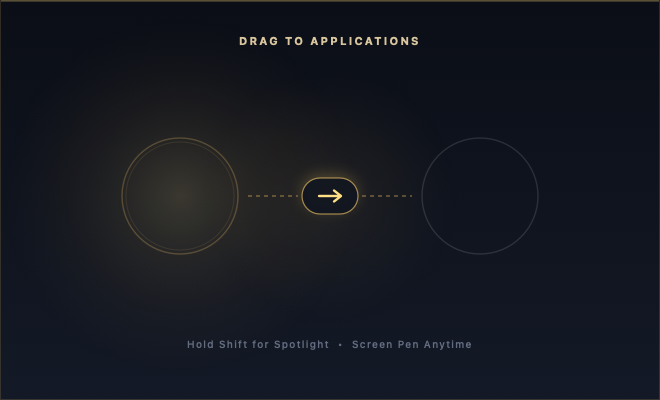

<p align="center">
  
</p>

# SpotPen

**Distraction-free screen annotation and instant spotlight presentations for macOS.**

SpotPen turns your entire screen into an immediate, presentation-ready canvas. Draw smoothly over any active application with a single calibrated precision pen, or hold <kbd>Shift</kbd> to focus audience attention under a gentle radial spotlight. No toolbars to manage, no palette configuration, and no interruption to your presentation flow.

<p align="center">
  <a href="https://github.com/unamatasanatarai/SpotPen/releases/latest"><b>Download Latest Release</b></a> •
  <a href="#quick-start"><b>Quick Start</b></a> •
  <a href="#how-it-works"><b>How It Works</b></a> •
  <a href="#keyboard-and-mouse-controls"><b>Shortcuts</b></a>
</p>

<p align="center">
  
  
  
  
  
</p>

---

<p align="center">
  
</p>

---

## Why SpotPen

Presenting technical concepts, conducting live code walkthroughs, or recording screencasts requires keeping viewers focused. Traditional screen drawing tools often get in the way: they clutter the display with floating tool palettes, require switching back and forth between drawing and pointing modes, and introduce input latency.

SpotPen eliminates tool-switching friction by operating on a single, continuous principle:

- **It is always a pen** when you want to annotate, sketch diagrams, or highlight code.
- **It is instantly a spotlight** the moment you hold <kbd>Shift</kbd> to dim distracting background windows and illuminate key details.
- **It disappears completely** when you release or toggle it, leaving no lingering UI behind.

---

## Key Capabilities

### Fluid Dual-Mode Workflow (Always Pen, Shift for Spotlight)
Annotate freely anywhere on your screen. The moment you press and hold <kbd>Shift</kbd>, SpotPen instantly transitions from freehand ink to an atmospheric radial spotlight aperture that follows your cursor. Releasing <kbd>Shift</kbd> immediately restores the pen. You never need to click an icon or switch tools mid-sentence.

### Single Calibrated Ink Color
Avoid decision fatigue during live presentations. SpotPen uses a single, carefully tuned vibrant coral red with 10% transparency (`alpha: 0.90`) and a subtle downward drop shadow. The ink remains sharp, elevated, and legible across dark IDE themes, bright browser windows, and full-screen slides alike.

### Dynamic Target Reticle Cursor
The pen cursor features a high-contrast concentric target reticle. The inner circle dynamically matches your exact pen stroke diameter, framed by a larger outer guidance circle, 4-way crosshairs, and a precision center dot. You always know your exact line weight before drawing.

### True Optical Radial Spotlight
When active, the spotlight darkens your entire display with a smooth 72% dark scrim, punching out a soft circular transparent aperture at your cursor with a natural radial gradient falloff using CoreGraphics `.destinationOut` composition.

### Independent Tool Resizing via Scroll Wheel
Adjust sizes on the fly without menus. Scrolling up enlarges your active tool; scrolling down shrinks it. Tool sizing is strictly independent: adjusting size while holding <kbd>Shift</kbd> resizes only the spotlight aperture radius (40–400 pt), while adjusting size during normal pen mode modifies only the pen stroke width (1–40 pt).

### Zero-Friction Global Hotkey & Custom Recorder
Activate SpotPen from any desktop, workspace, or full-screen app via global Carbon hotkey registration (default: <kbd>⌘</kbd> + <kbd>⇧</kbd> + <kbd>A</kbd>). Select from built-in quick presets or record any custom shortcut combination using the built-in HUD shortcut recorder.

### Menu Bar Resident with Adaptive Themes
SpotPen lives quietly in your menu bar (`LSUIElement = true`) with zero dock clutter. The status bar icon supports **Auto (Match System)** using macOS template rendering, as well as dedicated **Light Mode (Dark Icon)** and **Dark Mode (Light Icon)** overrides.

---

## How It Works

SpotPen runs an edge-to-edge transparent borderless window above standard desktop window tiers (`.screenSaver` window level), enabling instant annotation across any active application:

```text
1. Press ⌘⇧A (or custom hotkey) from any screen to activate SpotPen.
2. Click and drag to draw freehand annotations with natural drop shadow depth.
3. Hold Shift to immediately illuminate a specific area with the spotlight aperture.
4. Scroll up or down to independently resize the active tool.
5. Press C to clear all drawings, or ⌘Z to undo recent strokes.
6. Press ⌘⇧A again to dismiss the overlay and return to your desktop.
```

---

## Keyboard and Mouse Controls

| Action | Shortcut / Gesture | Behavior |
|---|---|---|
| **Toggle SpotPen** | <kbd>⌘</kbd> + <kbd>⇧</kbd> + <kbd>A</kbd> *(or custom hotkey)* | Opens or dismisses the screen overlay |
| **Draw Ink** | Left-Click + Drag | Draws freehand strokes in vibrant coral red with drop shadow |
| **Spotlight Mode** | Hold <kbd>Shift</kbd> | Casts radial gradient spotlight following cursor; release to resume pen |
| **Resize Active Tool** | Scroll Wheel Up / Down | Enlarges or shrinks current tool (pen width or spotlight radius) |
| **Resize via Keyboard** | <kbd>[</kbd> / <kbd>]</kbd> | Decreases or increases the active tool size |
| **Undo Stroke** | <kbd>⌘</kbd> + <kbd>Z</kbd> | Restores canvas to previous stroke state |
| **Clear Screen** | <kbd>C</kbd> / <kbd>Delete</kbd> / <kbd>Backspace</kbd> | Clears all annotations on screen |
| **Dismiss Overlay** | <kbd>Escape</kbd> | Hides SpotPen overlay without losing state |

---

## What Makes It Different

- **Hardware-Level Key State Inspection**: Rather than relying on fragile application-level focus routing, SpotPen directly monitors Shift key hardware state via CoreGraphics (`CGEventSource.keyState`), ensuring instant, jitter-free spotlight transitions without requiring Accessibility permissions.
- **Zero External Dependencies**: Built entirely with Swift, AppKit, and CoreGraphics. No third-party frameworks, no Electron overhead, and minimal resource usage.
- **Engineered for Presentations**: Eliminates multiple colors, complex shapes, and nested menus in favor of a single tool designed to keep presentations fluid and focused.

---

## Quick Start

### Installation via DMG

1. Download the latest release disk image: [**SpotPen Releases**](https://github.com/unamatasanatarai/SpotPen/releases/latest).
2. Open the downloaded `.dmg` file.
3. Drag **SpotPen.app** into your **Applications** folder.
4. Launch SpotPen from Applications or Spotlight. The pen icon will appear in your menu bar.

### Building from Source

SpotPen compiles directly using native macOS command-line tools without requiring Xcode project files:

```bash
# Clone the repository
git clone https://github.com/unamatasanatarai/SpotPen.git
cd SpotPen

# Compile the application bundle into build/SpotPen.app
make build

# Launch the compiled application
make run

# Run native Swift unit test suite
make test

# Build the distributable styled DMG package
make dmg
```

---

## Development & Makefile Targets

| Target | Description |
|---|---|
| `make build` | Compiles the native `.app` bundle into `build/SpotPen.app` and increments build counter |
| `make run` | Terminates any active instance, rebuilds, and launches `SpotPen.app` |
| `make kill` | Safely terminates running SpotPen processes |
| `make test` | Executes the native Swift test suite covering geometry, models, and controllers |
| `make dmg` | Compiles the app and packages it into a styled DMG with custom volume and file icons |
| `make revoke` | Resets TCC permissions and flushes macOS LaunchServices and QuickLook caches |
| `make clean` | Removes build artifacts and temporary test binaries |

---

## Testing & Quality

SpotPen includes an integrated native Swift unit test suite that validates core geometry, state transitions, and canvas behavior:

```bash
make test
```

Tests verify:
- **Geometry & Splines**: Smooth Bézier path generation, midpoint distance calculation, and spotlight radius boundary clamps.
- **State Machine**: Tool transitions from pen to spotlight on hardware Shift events, undo stack state, and canvas clear operations.
- **Cursor Generation**: Dynamic cursor reticle sizing and hot-spot precision.
- **Appearance & Shortcuts**: Menu bar controller initialization, icon theming modes, and Carbon hotkey parsing.

---

## License

This project is licensed under the [GNU General Public License v2.0](LICENSE).
